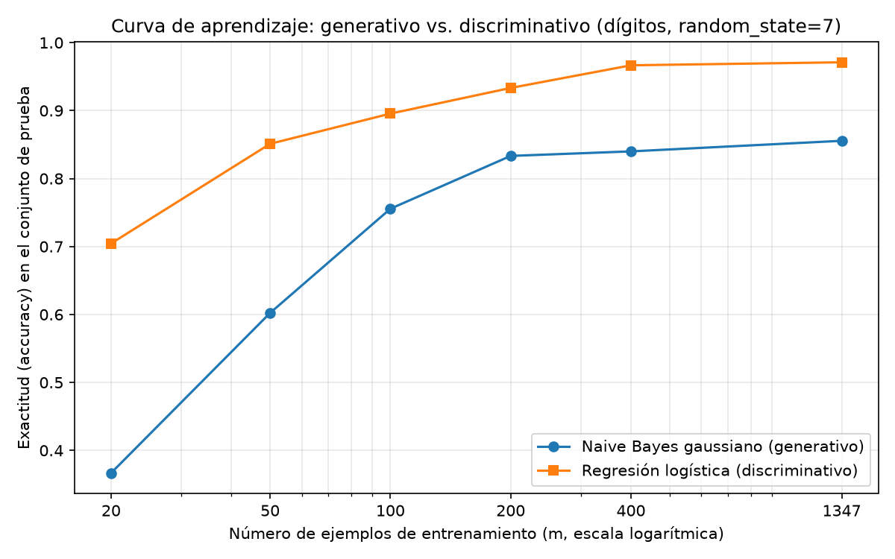

# Tarea A — ¿Gana el generativo con pocos datos? Ng y Jordan sobre dígitos

## Introducción

Ng y Jordan (2001) sostienen que un clasificador generativo como Naive Bayes se acerca a su error asintótico con menos ejemplos que su par discriminativo, la regresión logística, aunque dicho error asintótico sea mayor. Esto implica dos regímenes de desempeño: con pocos datos convendría el generativo y con muchos el discriminativo, con un cruce entre ambas curvas. Esta tarea pone a prueba esa predicción sobre los dígitos manuscritos que trae scikit-learn, comparando GaussianNB contra LogisticRegression en una partición única de entrenamiento y prueba, y trazando la exactitud en función del número de ejemplos de entrenamiento.

## Metodología

Se cargó `load_digits` (1797 ejemplos, 64 atributos, 10 clases) y se dividió en 75 %/25 % estratificando por clase con `random_state=7`, lo que produjo 1347 ejemplos de entrenamiento y 450 de prueba (proporciones 0.7496 y 0.2504). Esta partición es la única de toda la tarea: el conjunto de prueba no se usó para ajustar ni para elegir nada.

Se entrenó GaussianNB con sus valores por defecto sobre los atributos originales, sin escalar, y LogisticRegression(max_iter=3000) sobre atributos estandarizados con un StandardScaler ajustado solo con el conjunto de entrenamiento. Se midió accuracy y F1 macro de cada modelo sobre el conjunto de prueba.

Para la curva de aprendizaje se reentrenaron ambos modelos con m = 20, 50, 100, 200 y 400 ejemplos, y con el entrenamiento completo (1347). Cada submuestra se obtuvo con `train_test_split(X_train, y_train, train_size=m, stratify=y_train, random_state=7)` y la evaluación fue siempre sobre el mismo conjunto de prueba. La figura se guardó como PNG.

## Resultados

### Parte 2 — Desempeño sobre el conjunto de prueba

| Modelo | Accuracy | F1 macro |
|---|---|---|
| GaussianNB (atributos sin escalar) | 0.8556 | 0.8552 |
| LogisticRegression (atributos escalados) | 0.9711 | 0.9711 |

La regresión logística supera a GaussianNB en ambas métricas sobre prueba.

### Parte 3 — Curva de aprendizaje

| m (ejemplos de entrenamiento) | Accuracy GNB | Accuracy LR |
|---|---|---|
| 20 | 0.3667 | 0.7044 |
| 50 | 0.6022 | 0.8511 |
| 100 | 0.7556 | 0.8956 |
| 200 | 0.8333 | 0.9333 |
| 400 | 0.8400 | 0.9667 |
| 1347 (completo) | 0.8556 | 0.9711 |

## Discusión

Con estas cifras **no se observa el cruce** que predicen Ng y Jordan: la regresión logística supera a GaussianNB en todos los tamaños probados, desde m=20 (0.7044 contra 0.3667) hasta el entrenamiento completo (0.9711 contra 0.8556). La brecha se estrecha a medida que crece m, pero las curvas nunca se cruzan dentro del rango evaluado.

El supuesto del modelo generativo que puede fallar en estos datos es la **independencia condicional entre atributos** que impone Naive Bayes. En imágenes de dígitos los píxeles vecinos están fuertemente correlacionados, pues un mismo trazo abarca varios píxeles contiguos; modelar cada píxel como una gaussiana independiente produce un error asintótico claramente peor. En términos de Ng y Jordan, el generativo converge más rápido, pero hacia un techo (0.8556) muy por debajo del discriminativo (0.9711): la ventaja en velocidad de convergencia no alcanza a compensar esa distancia, y el cruce quedaría fuera de cualquier rango de tamaños práctico, si es que ocurre.

Adicionalmente, con m=20 el ajuste de GaussianNB es muy inestable: debe estimar medias y varianzas de 64 atributos por cada una de las 10 clases usando apenas 20 ejemplos repartidos entre las clases, lo que explica su caída a 0.3667. La regresión logística, en cambio, ya con 20 ejemplos alcanza 0.7044 y mejora de forma sostenida hasta 0.9711.

Sobre desde qué tamaño conviene cada modelo: en estos datos la regresión logística conviene en todo el rango probado (de 20 a 1347 ejemplos). GaussianNB no llegó a ser preferible en ningún punto, de modo que la recomendación práctica para este conjunto es usar el modelo discriminativo desde el inicio.

## Conclusiones

- La partición estratificada 75 %/25 % con random_state=7 produjo 1347 ejemplos de entrenamiento y 450 de prueba, a partir de 1797 dígitos con 64 atributos y 10 clases; el conjunto de prueba se reservó exclusivamente para evaluación.
- Sobre prueba, LogisticRegression con atributos escalados alcanzó accuracy 0.9711 y F1 macro 0.9711, frente a 0.8556 y 0.8552 de GaussianNB sin escalar.
- La curva de aprendizaje no muestra el cruce anunciado por Ng y Jordan: el modelo discriminativo gana desde m=20 hasta el conjunto completo, aunque la diferencia disminuye al crecer m.
- El candidato natural a explicar el pobre techo del generativo es el incumplimiento de la independencia condicional entre píxeles vecinos, típico de datos de imágenes.
- Lección práctica: la predicción teórica de dos regímenes supone que el error asintótico del generativo no esté demasiado lejos del discriminativo; cuando el supuesto de independencia falla fuerte, como aquí, el discriminativo domina en todo el rango de tamaños de entrenamiento probado.