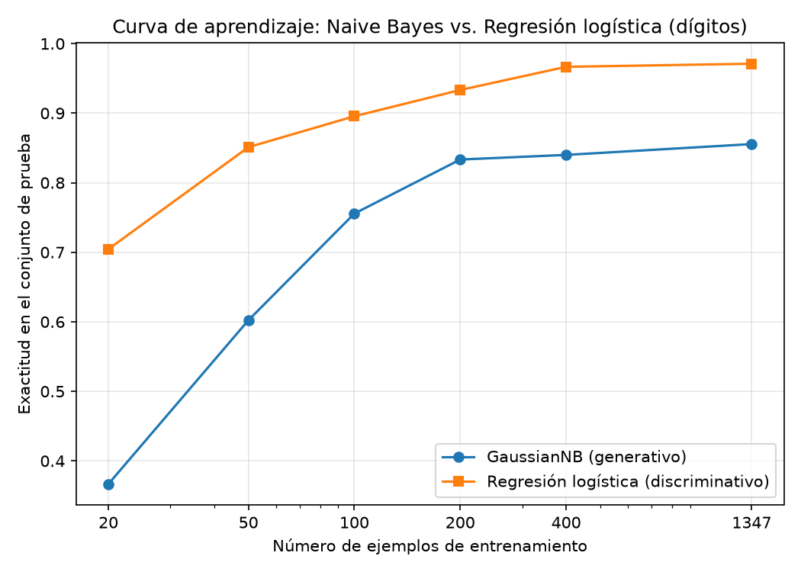

# ¿Gana el clasificador generativo con pocos datos? Ng y Jordan sobre dígitos manuscritos

## Introducción

Ng y Jordan (2001) sostienen, para el par generativo-discriminativo formado por Naive Bayes y regresión logística, que el modelo generativo se acerca a su error asintótico con muchos menos ejemplos de entrenamiento, aunque ese error asintótico sea mayor que el del discriminativo. Esto predice dos regímenes de desempeño: con pocos datos convendría el generativo y, al crecer el conjunto de entrenamiento, lo superaría el discriminativo. Esta tarea pone a prueba esa predicción sobre imágenes de dígitos manuscritos de scikit-learn, comparando un Naive Bayes gaussiano con una regresión logística bajo una única partición de entrenamiento y prueba.

## Metodología

Se cargó el conjunto de dígitos (`sklearn.datasets.load_digits`), con 1797 ejemplos, 64 atributos y 10 clases. Se dividió en 75 % entrenamiento (1347 ejemplos) y 25 % prueba (450 ejemplos), estratificando por clase con `random_state=7`. Esa partición única se usó en toda la tarea: el conjunto de prueba nunca se empleó para ajustar ni para elegir nada.

Se entrenaron dos modelos: un `GaussianNB` con sus valores por defecto sobre los atributos originales, sin escalar, y una `LogisticRegression(max_iter=3000)` sobre atributos estandarizados con un `StandardScaler` ajustado solo con el conjunto de entrenamiento. Se midió la exactitud (accuracy) y el F1 macro de cada modelo sobre el conjunto de prueba.

Para la curva de aprendizaje, cada modelo se reentrenó con submuestras de 20, 50, 100, 200 y 400 ejemplos y con el entrenamiento completo (1347), obtenidas con `train_test_split` sobre el conjunto de entrenamiento (`train_size=m`, estratificado, `random_state=7`), evaluando siempre sobre el mismo conjunto de prueba. La exactitud se graficó contra el número de ejemplos y se guardó como PNG.

## Resultados

### Desempeño en el conjunto de prueba (Parte 2)

| Modelo | Accuracy | F1 macro |
|---|---|---|
| GaussianNB | 0.8556 | 0.8552 |
| LogisticRegression | 0.9711 | 0.9711 |

### Curva de aprendizaje (Parte 3)

Exactitud en prueba según el tamaño de entrenamiento m:

| m | GaussianNB | Regresión logística |
|---|---|---|
| 20 | 0.3667 | 0.7044 |
| 50 | 0.6022 | 0.8511 |
| 100 | 0.7556 | 0.8956 |
| 200 | 0.8333 | 0.9333 |
| 400 | 0.84 | 0.9667 |
| 1347 (completo) | 0.8556 | 0.9711 |

Figura: curva de aprendizaje de ambos modelos (exactitud contra número de ejemplos de entrenamiento).

La regresión logística supera al Naive Bayes gaussiano en todos los tamaños evaluados, incluido el más pequeño (m=20). El Naive Bayes mejora con rapidez al inicio y se estabiliza pronto cerca de su valor final, mientras que la regresión logística sigue mejorando hasta el conjunto completo.

## Discusión

Con estas cifras no se observa el cruce que predicen Ng y Jordan (2001): el modelo discriminativo gana en todos los tamaños de entrenamiento, incluso con solo 20 ejemplos, donde alcanza 0.7044 frente a 0.3667 del generativo. Sí se confirma, en cambio, la otra mitad de la predicción: el generativo se acerca rápido a su asíntota. GaussianNB pasa de 0.3667 con 20 ejemplos a 0.8333 con 200, y con los 1347 ejemplos completos apenas llega a 0.8556; su curva se aplana mucho antes que la de la regresión logística, que continúa subiendo de 0.9333 con 200 ejemplos a 0.9711 con el conjunto completo. Es decir, el generativo converge pronto, pero hacia un techo claramente peor.

La explicación más plausible del desempeño del generativo está en el supuesto de independencia condicional entre atributos. En imágenes de dígitos, los píxeles vecinos están fuertemente correlacionados: el trazo que oscurece un píxel casi siempre oscurece a sus vecinos. Al modelar cada píxel con una gaussiana independiente por clase, Naive Bayes trata la evidencia de regiones correlacionadas como si fuera independiente, contando varias veces la misma información y produciendo decisiones degradadas. Ese sesgo del modelo empeora tanto su error asintótico que ni siquiera la convergencia rápida prevista por Ng y Jordan alcanza para superar al discriminativo. La regresión logística, al no suponer independencia y ajustar los pesos de forma conjunta, parte con un error asintótico menor y, con solo 64 atributos y 10 clases, necesita relativamente pocos ejemplos para acercarse a él.

Sobre desde qué tamaño conviene cada modelo: en estos datos, la regresión logística conviene en todo el rango probado, desde 20 ejemplos hasta el conjunto completo. El generativo solo sería preferible en regímenes de datos aún más escasos que los probados, o cuando el supuesto de independencia sea razonablemente cierto; ninguna de las dos condiciones se cumple aquí.

## Conclusiones

- La partición estratificada única produjo 1347 ejemplos de entrenamiento y 450 de prueba a partir de 1797 dígitos con 64 atributos y 10 clases.
- En prueba, la regresión logística (accuracy 0.9711, F1 macro 0.9711) superó al Naive Bayes gaussiano (0.8556 y 0.8552).
- La curva de aprendizaje no muestra el cruce anunciado por Ng y Jordan (2001): el discriminativo gana desde m=20. Sí se confirma la convergencia rápida del generativo, que se estabiliza pronto en un nivel asintótico inferior, coherente con el supuesto de independencia condicional que violan los píxeles vecinos.
- Para este conjunto de imágenes, la regresión logística es la elección adecuada en todos los tamaños de entrenamiento probados.